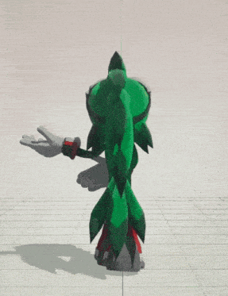

<h1 align="center">
Hey , I'm Ali Faniani
</h1>

<h3 align="center">
Building AI-Powered Applications with Deep Learning & Modern Software Engineering
</h3>

I enjoy transforming ideas into intelligent systems through AI, software engineering, and continuous learning.

  
  &nbsp;&nbsp;
  
  &nbsp;&nbsp;
  
  &nbsp;&nbsp;
  

---

## 🔴 About Me

- 🎓 I earned my **B.Sc. in Computer Science from Shahid Chamran University of Ahvaz** and I am passionate about building intelligent software solutions and exploring the world of Artificial Intelligence.

- 🤖 Currently focused on **Deep Learning, Computer Vision, and AI-powered applications**, with a strong interest in transforming research ideas into practical products.

- 🚀 I enjoy designing and developing software systems, from AI models and APIs to complete web applications.

- 🧠 My main areas of interest:
  **Artificial Intelligence, Machine Learning, Neural Networks, Computer Vision, Backend Development, and Software Engineering**

- 🦅 **"Greenhawk"** is my personal identity and developer brand — representing creativity, curiosity, and my journey of building technology with passion.

- 💪 Outside of programming, I enjoy **fitness, bodybuilding, and continuous self-improvement**.

---

## 🛠️ Tech Stack

### 💻 Programming Languages

  

### 🤖 AI & Machine Learning

  

### 🌐 Backend & Web Development

  

REST APIs • AI Integration • Web Applications

### ⚙️ Tools & Platforms

  

### 🤗 AI Platforms

Hugging Face

&nbsp;

&nbsp;

---

## 🚀 Featured Projects

<table>
<tr>
<td width="50%" align="center" valign="top">

<h3>🎮 <a href="https://github.com/Greenhawk5/HawkBucks-Web">HawkBucks</a></h3>

</td>
<td width="50%" align="center" valign="top">

<h3>🌐 <a href="https://github.com/Greenhawk5/AliFaniani-Portfolio">Ali Faniani — Portfolio</a></h3>

</td>
</tr>
<tr>
<td width="50%" align="center" valign="bottom">

A community-driven tracker that automatically finds Fortnite: Save the World V-Bucks missions and presents their rewards, zones, and Power Levels.

  
  
  

    <a href="https://hawkbucks.com">Live Website ↗</a> ·
  <a href="https://github.com/Greenhawk5/HawkBucks-Web">Repository ↗</a>

</td>
<td width="50%" align="center" valign="bottom">

My personal developer portfolio: an SEO-first web experience paired with an interactive 3D developer room.

  
  
  

  <a href="https://alifaniani.ir">Live Website ↗</a> ·
  <a href="https://github.com/Greenhawk5/AliFaniani-Portfolio">Repository ↗</a>

</td>
</tr>
<tr>
<td width="50%" align="center" valign="top">

<h3>🎯 <a href="https://github.com/Greenhawk5/Buckshot-Tracker">Buckshot Tracker</a></h3>

</td>
<td width="50%" align="center" valign="top">

<h3>📈 <a href="https://github.com/Greenhawk5/HAWKLYX">HAWKLYX</a></h3>

</td>
</tr>
<tr>
<td width="50%" align="center" valign="bottom">

A tactical companion for Buckshot Roulette, tracking live and blank shells, calculating real-time probabilities, and maintaining shot history inside Telegram.

  
  
  
  

  <a href="t.me/BuckshotTrackerBot/tracker">Live App ↗</a> ·
  <a href="https://github.com/Greenhawk5/Buckshot-Tracker">Repository ↗</a>

</td>
<td width="50%" align="center" valign="bottom">

An Android Brent crude oil monitor featuring interactive market charts, market insights, home-screen widgets, and a Cloudflare-powered backend.

  
  
  

  <a href="http://cafebazaar.ir/app/?id=ir.alifaniani.hawklyx&ref=share">Live App ↗</a> ·
  <a href="https://github.com/Greenhawk5/HAWKLYX">Repository ↗</a>

</td>
</tr>
</table>

---

## 🧠 Other AI Experiments

Exploring:

- Neural Networks
- Classification Algorithms
- Feature Selection
- Data Analysis

---

##  Greenhawk's Daily Thought

<!-- QUOTE_START -->

> "Setting goals is the first step in turning the invisible into the visible."

> — Tony Robbins

<!-- QUOTE_END -->

---

## 📫 Get in Touch

  

  
  &nbsp;
  
  &nbsp;
  
  &nbsp;
  

 

⭐ Feel free to explore my repositories and connect with me!

